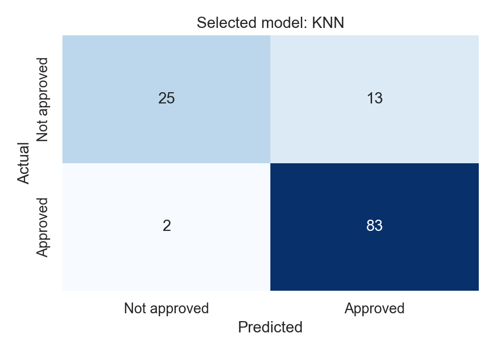

# Week 3: Supervised Learning Models

**Fayz Liaqat | 23 October 2026**

I compare KNN, a Decision Tree, and Logistic Regression on the loan dataset from Week 2.
I prepare the data, choose settings using validation data, and evaluate the fixed models on a separate test set.
I explain the errors, compare accuracy with F1, and include Linear Regression as an additional demonstration.

**Selected model: KNN with K = 5. Test accuracy: 87.80%.**

[Open the completed notebook](week3_supervised_models.ipynb) | [Download the two-page report](report/Week_3_Supervised_Models_Report.pdf)

## Dataset

| Item | Details |
| --- | --- |
| Dataset | Loan Predication |
| Source | [Kaggle, uploaded by amit parjapat](https://www.kaggle.com/datasets/ninzaami/loan-predication) |
| Included file | `data/loan_data.csv` |
| Raw size | 614 data rows and 13 columns |
| Target | `Loan_Status`: N = not approved, Y = approved |
| Class balance | 192 not approved (31.27%), 422 approved (68.73%) |
| Data quality | 149 missing cells across seven columns; zero exact duplicate rows |
| Inputs | Seven numeric and six categorical columns after adding the two Week 2 features |
| Processed inputs | 22 numeric columns after scaling and one-hot encoding |
| Kaggle license label | CC0: Public Domain |

The raw file is small and included, so the notebook needs no API key or dataset download. [Source notes](data/README.md) explain the original filename and row-count difference in the Kaggle description. The target records historical approvals, not repayment outcomes.

## How the comparison works

1. Check the data, remove exact duplicates, drop the ID, and create `totalIncome` and `hasCoapplicantIncome`.
2. Split 80/20 with stratification and `random_state=42`: 491 training rows and 123 test rows.
3. Split only the training data into 392 tuning rows and 99 validation rows.
4. Fit median imputation and `StandardScaler` on tuning numbers; fit mode imputation and one-hot encoding on tuning categories.
5. Choose K from 1, 3, 5, 7, 9, 11, 13, 15 using validation accuracy. Compare tree depths 2, 3, 5, 10, and None the same way.
6. Select the model family using validation macro-F1. Ties favor approval precision, then accuracy.
7. Refit fresh preprocessing and the fixed models on all 491 training rows. Use only `transform` on the test inputs.
8. Print five Logistic Regression probability estimates, evaluate the three classifiers, and inspect the selected model's errors.

K = 5 achieved 81.82% validation accuracy. Depths 2, 3, and 5 tied at 78.79%, so I kept depth 2. The unlimited tree reached 100% training accuracy but 75.76% validation accuracy, suggesting overfitting. KNN was selected before the test results were inspected.

## Test results

Precision, recall, and F1 below use **approved (1)** as the positive class. Macro-F1 averages the two class F1-scores equally.

| Model | Accuracy | Precision | Recall | F1 | Macro-F1 |
| --- | ---: | ---: | ---: | ---: | ---: |
| KNN, K = 5 | 87.80% | 0.8646 | 0.9765 | 0.9171 | 0.8432 |
| Decision Tree, depth = 2 | 84.55% | 0.8367 | 0.9647 | 0.8962 | 0.7973 |
| Logistic Regression | 86.18% | 0.8400 | 0.9882 | 0.9081 | 0.8147 |

KNN leads on validation macro-F1 and also has the highest test accuracy, approval precision, and macro-F1 among these classifiers. Logistic Regression has higher approval recall. This is a comparison on one small split, not evidence that KNN will always be best.



Rows are actual labels and columns are predictions. KNN correctly predicted 25 not-approved and 83 approved applications. It made 13 false approvals and 2 false rejections. It recognized only 25 of the 38 rejected applications, so the majority-class recall alone hides a weaker result for the rejected class.

For the hypothetical screening scenario, I assume false approvals are more costly and therefore prioritize approval precision. These are mistakes against historical labels, not evidence of loan defaults or measured financial loss.

## Bonus: accuracy can hide the weaker class

The training-fitted majority baseline gets **69.11% accuracy** and **0.8173 approval F1** while always predicting approved. Its rejected-class F1 is **0.0000** and macro-F1 is **0.4087**. KNN's rejected-class F1 is **0.7692**. The notebook includes both class reports and the baseline comparison.

## Linear Regression extra

The opening goal mentions Linear Regression while the detailed steps focus on three classifiers, so I include it in a separate section. I train ordinary Linear Regression on the 0/1 target and use a fixed 0.5 threshold for the classification comparison.

It gets **86.18% accuracy** and **0.9081 approval F1**. Its raw-score MAE is **0.2575**, RMSE is **0.3413**, and R-squared is **0.4543**. The raw scores range from **-0.0616 to 1.0180** and are not probabilities. It is not part of the three-classifier selection.

## How to run

Use Python 3.11 or newer. Clone or download the repository and open the project folder in a terminal:

```powershell
python -m venv venv
.\venv\Scripts\python.exe -m pip install -r requirements.txt
.\venv\Scripts\python.exe -m notebook week3_supervised_models.ipynb
```

On macOS or Linux, use `venv/bin/python` instead of `.\venv\Scripts\python.exe`.

In Jupyter, choose **Kernel > Restart Kernel and Run All Cells**. Keep the notebook in the project root so it can find `data/loan_data.csv`. Internet is needed to install packages, but not to run the completed notebook. A CPU is sufficient.

## Repository files

- `week3_supervised_models.ipynb`: one executed notebook, with Markdown before each step
- `data/loan_data.csv`: the original dataset
- `data/README.md`: dataset source and provenance
- `outputs/`: tuning curves, metric tables, classification reports, probabilities, error examples, and test predictions
- `report/Week_3_Supervised_Models_Report.pdf`: the two-page submission report
- `requirements.txt`: required packages

## Limitations

The results come from one fixed validation split and one test split. No parameters or thresholds were chosen from the test results. Cross-validation would give a more stable comparison in a later exercise. The estimated probabilities have not been calibrated, and this small historical dataset does not establish lending safety, fairness, or performance on new populations.
